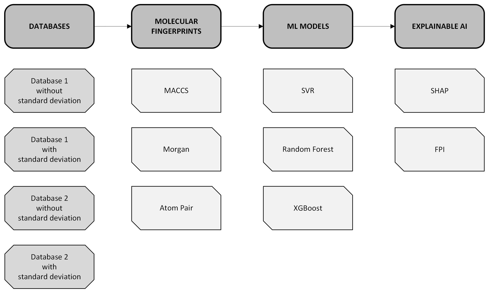
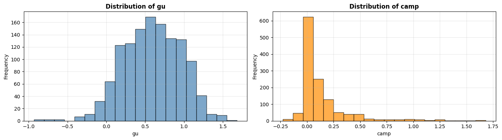
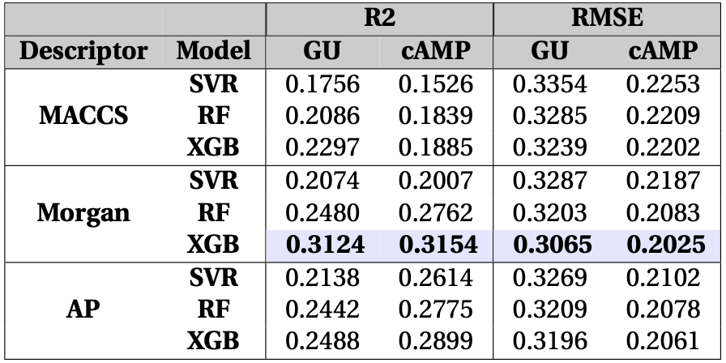
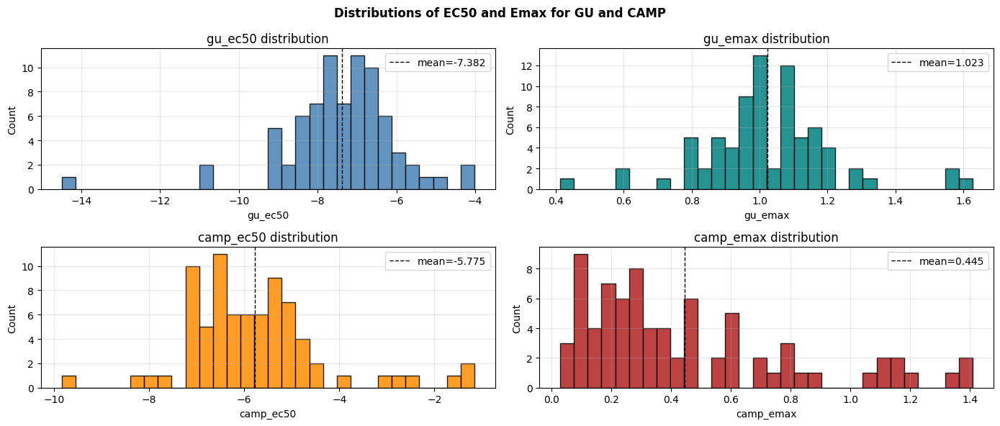
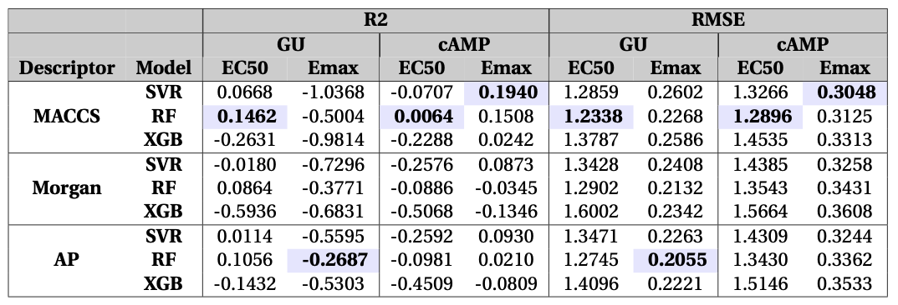

# Multi-output-bioactivity-prediction-model
Machine learning model for bioactivity prediction with two different labels (glucose uptake and cAMP). For this model, various molecular fingerprints, machine learning models and explainable AI (XAI) methods were used.

*This repository is part of my Master Thesis project and was done in collaboration with Atrogi.*

## Executive Summary
- **Project scope:** Build a bioactivity prediction model that considers glucose uptake and cAMP from proprietary molecular datasets from Atrogi.
- **Methodology:** Experimental quantitative approach using ML models such as SVR, Random Forest, XGBoost and GNNs with XAI methods such as SHAP and Feature Importance.
- **Results:** For dataset 1.1, Morgan fingerprints with XGBoost is more accurate. For dataset 4.3, MACCS fingerprints with random forest is more accurate. 
- **Analysis:** The limited size of dataset 4.3 seems to favor simpler fingerprint and ML model combinations. On the other hand, dataset 1.1 fares better with more complex models such as XGBoost, likely due to the bigger number of molecules.

## Context and Problem
The use of AI in the healthcare sector has exploded in the last years. 
In the drug development process, the process of drug discovery could prove fruitful both in terms of cost and time efficiencies. 
The overall process can take 10 years and 3 billion USD, with only a 10% success rate.
Among the processes in drug discovery, drug bioactivity reveals how much of a drug can causes an effect in the body. 
Traditional methods for bioactivity involve trial and error of numerous different molecules.
With enough rich dataset, the goal is to use ML and AI models to accelerate this process to improve resources and success rate of new drug developments.

## Tech Stack
- **Language:** Python with Jupyter Notebook
- **Libraries:** 
    - **numpy** & **matplotlib** for general data manipulation and visualization
    - **rdkit** for molecular fingerprints
    - **scikit-learn** & **XGBoost** for the machine learning models and model evaluation
    - **pytorch** for the graph neural network model
    - **SHAP** for the explainable AI methods 
- **Development:** VSCode for Python editing
- **Version Control:** Git/GitHub for versioned scripts

## Analysis Overview
### Models accuracy
#### Dataset 1.1:

Dataset 1.1 included 1269 molecules and its data label was a single value of 10 micromolars.
The results for the different molecular fingerprints match the same combination of XGBoost and Morgan fingerprints. 

#### Dataset 4.3:

Data 4.3 includes only 77 molecules, but its data labels are EC50 (the industry standard for bioactivity) and Emax.

### Key insights
- The results for dataset 1.1 are more stable, likely due to the higher dataset size. This allows more complex ensemble models like XGBoost to more accurately predict the glucose uptake and cAMP of the molecules. 
Similarly, MORGAN fingerprints with 2048 variables allow for the complexities of the molecular interactions to be learned for the ML model, providing more accuracy.
- The results for dataset 4.3 vary highly between fingerprint and ML model combinations. Even though the label is the standard for bioactivity, the lack of dataset examples hinder the capacity of the models to become stable. 
In order to build a more accurate model, it is likely that more examples are required.

## Data Science Skills Showcased
- **Data Cleaning:** Ingested and cleaned datasets with `pandas`, handling missing values and pruning irrelevant features.   
- **Cheminformatics:** Processed `SMILES` strings and generated 2048-bit ECFP4 Morgan fingerprints using `RDKit` alongside zero-variance feature filtering.   
- **Exploratory Data Analysis:** Visualized target distributions (`gu`, `camp`) and bit frequencies using `matplotlib`.   
- **Multi-Output Machine Learning:** Trained `SVR`, `Random Forest`, and `XGBoost` models utilizing standard scaling and multi-output regression wrappers.   
- **Model Validation & Diagnostics:** Implemented 5-fold cross-validation, evaluated RMSE and $R^2$ metrics, and analyzed train/val gaps and residuals.   
- **Explainable AI (XAI):** Leveraged `KernelSHAP` and `TreeSHAP`, engineered a custom normalized **Bias Score** for multi-objective optimization, and mapped atom-level SHAP values back onto molecular structures.   
